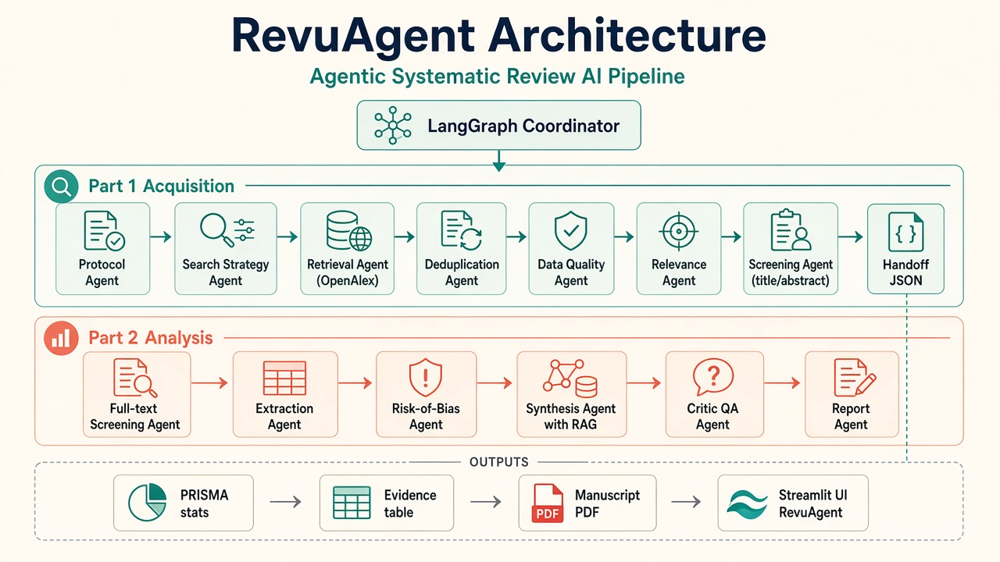

# RevuAgent

**Pipeline multi-agents pour revues systématiques transparentes et reproductibles (PRISMA 2020)**

RevuAgent automatise une revue de littérature de bout en bout :

- **Partie 1** — protocole, recherche bibliographique, déduplication, qualité, pertinence, screening titre/résumé, handoff ;
- **Partie 2** — screening full-text, extraction, risk-of-bias, synthèse RAG, critic QA, manuscrit (Markdown + PDF).

Ce README est la **documentation unique** des deux parties.

### Réalisation (collaboration)

| Partie | Périmètre | Réalisé par |
|---|---|---|
| **Partie 1** | Protocole, recherche OpenAlex, déduplication, qualité, pertinence, screening titre/résumé, handoff | Fatima Stitou |
| **Partie 2** | Screening full-text, extraction, risk-of-bias, RAG, synthèse, critic QA, manuscrit PDF, UI | Khouloud Bolif |

---

## Table des matières

1. [Vue d’ensemble](#1-vue-densemble)
2. [Architecture technique](#2-architecture-technique)
3. [Stack technologique](#3-stack-technologique)
4. [Installation](#4-installation)
5. [Configuration](#5-configuration)
6. [Partie 1 — Acquisition & triage](#6-partie-1--acquisition--triage)
7. [Handoff Partie 1 → Partie 2](#7-handoff-partie-1--partie-2)
8. [Partie 2 — Analyse & rapport](#8-partie-2--analyse--rapport)
9. [Interface web](#9-interface-web)
10. [Artefacts produits](#10-artefacts-produits)
11. [Évaluation](#11-évaluation)
12. [Structure du dépôt](#12-structure-du-dépôt)
13. [Limites et bonnes pratiques](#13-limites-et-bonnes-pratiques)
14. [Commandes rapides](#14-commandes-rapides)

---

## 1. Vue d’ensemble

### Objectif

À partir d’un **topic** et d’une **question de recherche**, le système exécute un workflow aligné PRISMA :

| Étape | Partie | Résultat |
|---|---|---|
| Protocole + stratégie de recherche | 1 | `research_protocol.json`, `search_strategy.json` |
| Retrieval OpenAlex | 1 | `articles_raw.json` / `articles.json` |
| Dédup + qualité + pertinence | 1 | corpus nettoyé + scores |
| Screening titre/résumé | 1 | `screening_results.*`, `prisma_statistics.json` |
| Revue humaine (HITL) | 1→2 | `human_review.xlsx` |
| Handoff | 1→2 | `part2_handoff.json` |
| Screening full-text | 2 | `fulltext_screening.json` |
| Extraction + RoB | 2 | `evidence_table.*`, `risk_of_bias.*` |
| RAG + synthèse + critic | 2 | `synthesis.json`, `critic_report.json` |
| Rapport final | 2 | manuscrit `.md` / `.pdf`, `evaluation.json` |

### Principes de conception

| Principe | Implémentation |
|---|---|
| Modularité | 13 agents spécialisés (7 en Partie 1, 6 en Partie 2) |
| Orchestration | LangGraph (workflows stateful) |
| Transparence | rationales, logs JSON, compteurs PRISMA |
| Human-in-the-loop | `human_review.xlsx` (Include / Exclude / Unclear) |
| Reproductibilité | artefacts dans `outputs/<topic>/` |
| Topic-agnostic | aucun hard-code métier : CLI / UI / `.env` |

---

## 2. Architecture technique



### Coordinateur

**LangGraph** orchestre les nœuds, maintient l’état partagé et déclenche l’export des artefacts.

- Workflow Partie 1 : `workflow/research_pipeline.py`
- Workflow Partie 2 : `workflow/part2_pipeline.py`

### Partie 1 — Acquisition & triage (7 agents)

| Agent | Fichier | Rôle |
|---|---|---|
| Protocol | `agents/protocol_agent.py` | Draft de protocole PRISMA |
| Search Strategy | `agents/search_strategy_agent.py` | Formulations de requêtes |
| Retrieval | `agents/retrieval_agent.py` | Collecte OpenAlex |
| Deduplication | `agents/deduplication_agent.py` | Suppression des doublons |
| Data Quality | `agents/data_quality_agent.py` | Complétude des métadonnées |
| Relevance | `agents/relevance_agent.py` | Score lexical explicable (local) |
| Screening | `agents/screening_agent.py` | Screening titre/résumé préliminaire |

**Sorties clés Partie 1 :** `part2_handoff.json` + `human_review.xlsx` (+ PDF open-access optionnels)

### Partie 2 — Analyse & rapport (6 agents)

| Agent | Fichier | Rôle |
|---|---|---|
| Full-text Screening | `agents/fulltext_screening_agent.py` | Éligibilité full-text (+ override humain) |
| Extraction | `agents/extraction_agent.py` | Tableau d’évidence structuré |
| Risk of Bias | `agents/risk_of_bias_agent.py` | Checklist d’appraisal simplifiée |
| Synthesis (+ RAG) | `agents/synthesis_agent.py` | Synthèse narrative ancrée |
| Critic / QA | `agents/critic_agent.py` | Cohérence, complétude, score qualité |
| Report | `agents/report_agent.py` | Manuscrit, PRISMA réconcilié, PDF |

### Flux de données (bout en bout)

```text
Topic / Question
    → [P1] Protocole + Stratégie
    → [P1] OpenAlex retrieval
    → [P1] Dédup + Qualité + Pertinence
    → [P1] Screening titre/résumé
    → [P1→P2] Handoff (+ revue humaine optionnelle)
    → [P2] Screening full-text
    → [P2] Extraction + RoB
    → [P2] Index RAG + Synthèse
    → [P2] Critic QA
    → [P2] Manuscrit (.md / .pdf) + evaluation.json
```

---

## 3. Stack technologique

| Couche | Technologie |
|---|---|
| Orchestration | LangGraph |
| Agents / LLM | LangChain, OpenAI ou Anthropic (optionnel, Partie 2) |
| Retrieval bibliographique | OpenAlex API (Partie 1) |
| RAG | index lexical local TF-IDF (`tools/rag_store.py`) |
| PDF parsing | PyMuPDF |
| Export | JSON, CSV, Excel, BibTeX, Markdown, PDF (`fpdf2`) |
| UI | Streamlit + Plotly |
| Config | `.env` via `python-dotenv` |

| Mode | Condition |
|---|---|
| Partie 1 sans LLM | **Toujours** (pertinence / screening lexicaux locaux) |
| Partie 2 LLM | si `OPENAI_API_KEY` ou `ANTHROPIC_API_KEY` |
| Partie 2 heuristic | si aucune clé LLM (règles locales transparentes) |

---

## 4. Installation

Prérequis : **Python 3.10+**.

```powershell
cd PROJET
python -m venv .venv
.venv\Scripts\Activate.ps1
python -m pip install --upgrade pip
pip install -r requirements.txt
copy .env.example .env
```

---

## 5. Configuration

Éditer `.env` (ne jamais committer ce fichier) :

```env
OPENALEX_EMAIL=votre_email@example.com
MAX_RESULTS=100

# Optionnel — active le mode LLM en Partie 2
OPENAI_API_KEY=sk-...
OPENAI_MODEL=gpt-4o-mini

# Alternative Anthropic
# ANTHROPIC_API_KEY=sk-ant-...
# ANTHROPIC_MODEL=claude-3-5-haiku-latest

# Optionnel — embeddings denses (sinon TF-IDF local)
# PART2_USE_OPENAI_EMBEDDINGS=1
# OPENAI_EMBEDDING_MODEL=text-embedding-3-small
```

| Variable | Effet |
|---|---|
| `OPENALEX_EMAIL` | Accès « polite pool » OpenAlex (Partie 1) |
| `MAX_RESULTS` | Plafond de retrieval par défaut |
| `OPENAI_API_KEY` | Mode LLM `openai` en Partie 2 |
| `ANTHROPIC_API_KEY` | Mode LLM `anthropic` en Partie 2 |
| (aucune clé LLM) | Mode `heuristic` en Partie 2 |

---

## 6. Partie 1 — Acquisition & triage

### Point d’entrée

```powershell
python main.py `
  --topic "Cybersecurity in IoT" `
  --question "What security threats and mitigation techniques are studied for IoT systems?" `
  --max-results 50 `
  --include iot security threat mitigation `
  --exclude editorial `
  --download-pdfs
```

### Paramètres CLI

| Argument | Description |
|---|---|
| `--topic` | Sujet de la revue (obligatoire) |
| `--question` | Question de recherche |
| `--max-results` | Nombre max d’enregistrements OpenAlex |
| `--include` / `--exclude` | Termes de screening titre/résumé |
| `--include-types` / `--exclude-types` | Politique de types de publication |
| `--year-from` / `--year-to` | Filtre temporel |
| `--download-pdfs` | Télécharge les PDF open-access signalés par OpenAlex |
| `--output-dir` | Dossier de sortie (sinon dérivé du topic) |

### Ce que fait la Partie 1

1. Génère un **protocole draft** et une **stratégie de requêtes**.
2. Interroge **OpenAlex** et récupère les métadonnées.
3. **Déduplique**, contrôle la **qualité** des champs, calcule un **score de pertinence** lexical.
4. Applique un **screening titre/résumé préliminaire** (non final au sens PRISMA).
5. Exporte les artefacts + le **handoff** vers la Partie 2.
6. Si `--download-pdfs` : tente le téléchargement des PDF OA dans `full_texts/`.

### Revue humaine (recommandée avant Partie 2)

Ouvrir `outputs/<topic_slug>/human_review.xlsx` et renseigner :

- `Include` / `Exclude` / `Unclear`
- notes éventuelles

Ces décisions **écrasent** le screening automatique lors de la Partie 2.

> Les décisions automatiques de Partie 1 sont **préliminaires**. Ne pas les reporter comme includes/excludes PRISMA finaux sans validation humaine.

---

## 7. Handoff Partie 1 → Partie 2

### Entrée principale

`outputs/<topic_slug>/part2_handoff.json`

Contient les enregistrements **non exclus automatiquement** par les règles préliminaires titre/résumé et type de publication (`potentially_include` + `uncertain`).  
**Ni l’un ni l’autre n’est une éligibilité finale.**

### Fichiers supports

| Fichier | Rôle |
|---|---|
| `human_review.xlsx` | Décisions humaines Include / Exclude / Unclear + notes |
| `full_texts/` | PDF OA téléchargés |
| `pdf_acquisition_results.json` | Statut d’acquisition PDF par enregistrement |
| `research_protocol.json` | Topic, question, critères, politique de types |
| `prisma_statistics.json` | Compteurs préliminaires Partie 1 |

### Champs importants dans le handoff

- Identité : `openalex_id`, `doi`, `title`, `year`, `authors`, `abstract`, `type`
- Accès : `landing_page_url`, `pdf_url`, `is_oa`
- Screening P1 : `title_abstract_decision`, `title_abstract_reason`
- Hits : `screening_inclusion_hits`, `screening_exclusion_hits`
- Qualité : `metadata_completeness`, `missing_metadata`
- HITL : `human_review_required`, `screening_is_final`

### Contrat attendu côté Partie 2

1. Enrichissement full-text si PDF manquant (dans les limites d’accès).
2. Décision d’éligibilité full-text (humaine prioritaire).
3. Extraction + risk-of-bias.
4. Synthèse RAG / narrative.
5. Réconciliation des compteurs PRISMA avec les décisions réelles.

Chargement implémenté dans `tools/handoff_loader.py`.

---

## 8. Partie 2 — Analyse & rapport

### Point d’entrée

```powershell
python main_part2.py --output-dir outputs/cybersecurity_in_iot
```

`--output-dir` doit pointer vers le dossier Partie 1 contenant `part2_handoff.json`.

### Ce que fait la Partie 2

1. Charge le handoff + protocole + décisions humaines + textes / PDF.
2. **Screening full-text** (override humain si renseigné).
3. **Extraction** structurée → evidence table.
4. **Risk of Bias** simplifié par domaine.
5. Construit l’**index RAG** local et produit une **synthèse narrative**.
6. **Critic / QA** : vérifie cohérence, complétude, citations → verdict + score.
7. Exporte manuscrit Markdown + PDF, PRISMA réconcilié, `evaluation.json`.

### Démo offline (sans OpenAlex)

Utile pour une soutenance sans réseau / sans run Partie 1 live :

```powershell
python tools/create_part2_demo_fixture.py --output-dir outputs/demo_cybersecurity_in_iot
python main_part2.py --output-dir outputs/demo_cybersecurity_in_iot
```

### Sorties console typiques

Après `main_part2.py` : mode LLM, nombre de records, décisions humaines appliquées, PDF parsés, includes, extractions, verdict critic, chemin du manuscrit.

---

## 9. Interface web

```powershell
python -m streamlit run ui/app.py
```

L’UI **RevuAgent** couvre les **deux parties** :

| Page | Fonction |
|---|---|
| **Lancer Partie 1** | Topic / question / critères → run acquisition + visualisation articles |
| **Lancer Partie 2** | Génération rapport à partir du handoff |
| **Rapport final** | Consultation / téléchargement du manuscrit PDF |

---

## 10. Artefacts produits

### Partie 1 — `outputs/<topic>/`

| Fichier | Description |
|---|---|
| `research_protocol.json` | Protocole draft |
| `search_strategy.json` | Stratégie de requêtes |
| `articles_raw.json` / `articles.json` | Corpus récupéré |
| `screening_results.json` / `.csv` | Décisions titre/résumé + rationales |
| `prisma_statistics.json` | Compteurs préliminaires |
| `duplicates.json` | Doublons détectés |
| `potentially_include.json` / `uncertain.json` | Subsets de screening |
| `human_review.xlsx` | Revue humaine |
| `pdf_acquisition_results.json` | Statuts PDF (si téléchargement) |
| `full_texts/` | PDF locaux |
| `part2_handoff.json` | Entrée de la Partie 2 |
| `part2_handoff.csv` | Vue tabulaire du handoff |

### Partie 2 — `outputs/<topic>/part2/`

| Fichier | Description |
|---|---|
| `fulltext_screening.json` | Décisions full-text |
| `evidence_table.json` / `.csv` | Extraction structurée |
| `risk_of_bias.json` / `.csv` | Appraisal |
| `rag_index/` | Index RAG local (`chunks`, `vectors`, `idf`, `meta`) |
| `synthesis.json` | Synthèse narrative |
| `critic_report.json` | QA (verdict + score + issues) |
| `prisma_reconciled.json` | Flux PRISMA final |
| `evaluation.json` | Métriques de complétude / transparence |
| `included_studies.bib` | Bibliographie des includes |
| `review_manuscript_draft.md` | Manuscrit draft |
| `review_manuscript_draft.pdf` | Export PDF téléchargeable |

---

## 11. Évaluation

Après un run Partie 2, consulter :

- `part2/evaluation.json`
- `part2/critic_report.json`

| Dimension | Indicateurs |
|---|---|
| **Complétude** | screened / included / extracted / appraised, `extraction_coverage` |
| **Transparence** | `rationale_rate`, `human_final_decisions` |
| **Cohérence** | `critic_verdict`, `critic_score`, `issues[]` |
| **Gain de temps** | wall-clock pipeline vs estimation manuelle sur le même corpus |

Document détaillé :

[`docs/evaluation_performances.pdf`](docs/evaluation_performances.pdf)

```powershell
Get-Content outputs/cybersecurity_in_iot/part2/evaluation.json
Get-Content outputs/cybersecurity_in_iot/part2/critic_report.json
```

Régénérer le PDF d’évaluation :

```powershell
python tools/build_evaluation_pdf.py
```

---

## 12. Structure du dépôt

```text
PROJET/
├── agents/                 # 13 agents (Partie 1 + Partie 2)
├── workflow/
│   ├── research_pipeline.py   # LangGraph Partie 1
│   └── part2_pipeline.py      # LangGraph Partie 2
├── tools/                  # OpenAlex, PDF, handoff, RAG, export PDF
├── ui/                     # Interface Streamlit RevuAgent
├── docs/                   # Architecture + PDF évaluation
├── outputs/                # Résultats des runs (non versionnés)
├── main.py                 # CLI Partie 1
├── main_part2.py           # CLI Partie 2
├── requirements.txt
├── .env.example
└── README.md               # Documentation unique (ce fichier)
```

---

## 13. Limites et bonnes pratiques

1. Les décisions automatiques de **Partie 1** sont préliminaires : valider via `human_review.xlsx` avant de communiquer des includes/excludes finaux.
2. Utiliser `prisma_reconciled.json` (Partie 2) pour les compteurs PRISMA finaux, pas uniquement les stats Partie 1.
3. Une seule source bibliographique est branchée actuellement : **OpenAlex**.
4. Le manuscrit généré est un **draft d’aide** : vérifier citations, extractions et éligibilité avant usage académique.
5. Ne jamais committer `.env` (clés API).
6. Pour une démo de soutenance : un topic unique, un run Partie 1 propre, handoff validé, run Partie 2, PDF final.

---

## 14. Commandes rapides

```powershell
# Install
pip install -r requirements.txt
copy .env.example .env

# Partie 1
python main.py --topic "Cybersecurity in IoT" --question "What security threats and mitigation techniques are studied for IoT systems?" --max-results 50 --include iot security threat mitigation --exclude editorial --download-pdfs

# Partie 2
python main_part2.py --output-dir outputs/cybersecurity_in_iot

# Démo offline Partie 2
python tools/create_part2_demo_fixture.py --output-dir outputs/demo_cybersecurity_in_iot
python main_part2.py --output-dir outputs/demo_cybersecurity_in_iot

# UI (Partie 1 + Partie 2)
python -m streamlit run ui/app.py
```

---

## Références

- Cahier des charges : `projet/Project Agentic AI Pipeline.pdf`
- Architecture : [`docs/revuagent_architecture.jpg`](docs/revuagent_architecture.jpg)
- Évaluation des performances : [`docs/evaluation_performances.pdf`](docs/evaluation_performances.pdf)
